# TokenTally AI

COMP 8547 Advanced Computing Concepts, Fall 2026, Group 10.

TokenTally AI crawls the official pricing pages of five AI providers (OpenAI, Google Gemini, Anthropic Claude, Z.ai and xAI Grok), puts every model price in one format, and lets you search, compare and work out what a workload will cost per month.

## Team

| Member | Provider | Features |
|---|---|---|
| Nishan Giri | Anthropic Claude | spell checking, workload cost calculator |
| Abhinav Pandey | OpenAI | inverted indexing, frequency count |
| Shrijana Karki | Google Gemini | page ranking, data validation |
| Aakriti Mainali | Z.ai | word completion, finding patterns |
| Khem Raj Adhikari | xAI Grok | search frequency, html cleaning |

## Folders

- `core` plain java back end. All the features live here. Only the jdk is used. Eclipse project files are included.
- `api` spring boot app. It compiles `core` together with itself and serves the web page from `api/src/main/resources/static/index.html` (one page, plain javascript, tailwind saved next to it as `tailwind.js`). No node and no internet needed.
- `docs` our proposal, the requirements in our own words, the plan and the report draft.

You need java 17 or newer. Maven is only needed for `api` (Eclipse has it built in).

## How it works

The data goes through the same steps for every provider:

```
crawler (queue + hash set) -> html cleaner -> parser per provider
  -> data store (csv + text files) -> engine -> features
  -> menu (TokenTallyApp) or spring boot page (api)
```

| Part | How it works | Data structure and cost |
|---|---|---|
| crawler | breadth first search from the pricing page, follows only the links each provider allows, depth 2, at most 20 pages, 400 ms wait, robots.txt checked, urls cleaned first | queue and hash set, O(pages + links) |
| html cleaner | removes scripts, styles, svg and tags, keeps plain text with single spaces | one pass, O(n) |
| parsers | one per provider because every page is built differently, all fill the same `ModelPrice` (dollars per million tokens, -1 means not listed) | tables and regex |
| inverted index | word to page to list of positions, also gives phrase search | hash map, add O(words), lookup O(1) average |
| frequency count | counts a word on a page with Boyer-Moore and KMP and shows how many characters each one compared | KMP O(n + m), Boyer-Moore skips ahead |
| spell checking | edit distance between the typed word and the known words, best few kept, search is repeated with the best suggestion | dp table O(a x b) and a heap |
| word completion | letters are stored in a tree with a count on each word, the most used words under a prefix come first | trie and a heap |
| search frequency | counts every search and saves the counts to a file | hash map, tree map for the top list |
| page ranking | score is how often the keywords show up, a tie goes to the page with more different keywords | max heap, O(n log n) |
| data validation | regex checks for search words, token amounts (2M, 500K), percents and money, and sanity checks on crawled prices | regex |
| finding patterns | regex finds prices, context sizes, dated prices, long context limits, model ids and free offers | regex |
| cost calculator | monthly cost = days x (uncached input x input price + cached input x cached price + output x output price) / 1 million, long prices when one request is big enough, batch or flex tiers only when batch is fine | min heap, O(n log n) |
| price history | every load or crawl writes a dated line to `core/data/price_history.csv` when a price is new or different | append only log, hash map of last prices |

### The menu and what it prints

Search with a typo (option 1), the spell suggestion and the ranked pages:

```
loading data from data ...
TokenTally AI  |  194 model prices  |  81 pages  |  4713 words

1
> search for: gemnii
searched 6 time(s) so far
"gemnii" not found. did you mean: gemini genie genai
showing results for "gemini"
pages ranked by how often the words show up:
 1. 183  https://aistudio.google.com/docs/pricing (1 keyword(s))
 2. 18   https://aistudio.google.com/docs/models/gemini-3.1-pro-preview (1 keyword(s))
 3. 16   https://aistudio.google.com/docs/models/gemini-3.5-flash-lite (1 keyword(s))
 4. 16   https://aistudio.google.com/docs/models/gemini-4-argon (1 keyword(s))
 5. 15   https://aistudio.google.com/docs/models/gemini-3.1-flash-lite (1 keyword(s))
 6. 15   https://aistudio.google.com/docs/models/gemini-3.6-flash (1 keyword(s))
 7. 12   https://aistudio.google.com/docs/models/gemini-4-hydrogen (1 keyword(s))
 8. 11   https://aistudio.google.com/docs/models/gemini-3.1-flash-live-preview (1 keyword(s))
 9. 11   https://aistudio.google.com/docs/models/gemini-3.5-transcribe (1 keyword(s))
10. 11   https://aistudio.google.com/docs/models/gemini-4-carbon (1 keyword(s))
```

Bad input is stopped with a short message:

```
loading data from data ...
TokenTally AI  |  194 model prices  |  81 pages  |  4713 words

1
> search for: @@@bad
input problem: use letters, digits, spaces, dots and dashes only (max 60 chars)
```

Word completion (option 2):

```
loading data from data ...
TokenTally AI  |  194 model prices  |  81 pages  |  4713 words

2
> start of a word: claude-op
claude-opus-5-5, claude-opus-4-8, claude-opus-5, claude-opus-4-6, claude-opus-4-7, claude-opus-4-5, claude-opus-4-5-20251101
```

Cost calculator (option 8), 2M input and 500K output tokens a day, 20 percent cached, 250K requests, budget 500 dollars:

```
loading data from data ...
TokenTally AI  |  194 model prices  |  81 pages  |  4713 words

8
> input tokens per day (like 2M or 500K): 2M
output tokens per day: 500K
share of input that hits the cache in percent (enter for 0): 20
is batch processing fine? (y/n): n
tokens in one request (enter to skip): 250K
smallest context window you need (enter to skip): 
monthly budget in $ (enter for no limit): 500
only one provider? (enter for all): 
cheapest models for this workload, per month:
 1. glm-4.5-flash                      zai        $      0.00  (input $0.00, cached $0.00, output $0.00) standard, free
 2. glm-4.6v-flash                     zai        $      0.00  (input $0.00, cached $0.00, output $0.00) standard, free
 3. glm-4.7-flash                      zai        $      0.00  (input $0.00, cached $0.00, output $0.00) standard, free
 4. glm-ocr                            zai        $      2.25  (input $1.44, cached $0.36, output $0.45) standard, no cache price
 5. glm-4-32b-0414-128k                zai        $      7.50  (input $4.80, cached $1.20, output $1.50) standard, no cache price
 6. glm-4.6v-flashx                    zai        $      7.97  (input $1.92, cached $0.05, output $6.00) standard
 7. glm-4.7-flashx                     zai        $      9.48  (input $3.36, cached $0.12, output $6.00) standard
 8. gemini-2.5-flash-lite              gemini     $     10.92  (input $4.80, cached $0.12, output $6.00) standard
 9. glm-5.3-flash                      zai        $     15.06  (input $7.20, cached $0.36, output $7.50) standard, context 1000k
10. gemini-2.5-flash-image             gemini     $     18.59  (input $14.40, cached $3.60, output $0.59) standard, no cache price
```

Live crawl of the five providers (option 12, about one minute):

```
openai crawled 19 pages
gemini crawled 20 pages
anthropic crawled 20 pages
zai crawled 5 pages
  http 404 for https://docs.z.ai/guides/llm/base-ui-disable-scrollbar
  http 404 for https://docs.z.ai/guides/vlm/base-ui-disable-scrollbar
xai crawled 17 pages
parsed 194 model prices
```

Price history (option 13), the log starts at the first run so changes show after a later crawl:

```
loading data from data ...
TokenTally AI  |  194 model prices  |  81 pages  |  4713 words

13
> 194 price lines in the log, 0 price changes
no price has changed yet, crawl again later to see changes
```

All checks (`core/test.sh`):

```
ok   heap keeps order
ok   robots.txt rules
ok   url normalize and links
ok   html cleaner
ok   price cell helpers
ok   openai parser
ok   claude parser
ok   gemini parser
ok   z.ai parser
ok   xai parser
ok   tokenizer
ok   inverted index and phrase search
ok   boyer moore and kmp match a slow count
ok   edit distance
ok   spell checker
ok   trie and word completion
ok   search frequency saved to a file
ok   hardening: bad input and damaged files
ok   price history log
ok   error handling demo (no case may crash)
ok   experiments give sane numbers
ok   page ranking
ok   input validation
ok   pattern finding
ok   cost calculation
ok   recommendation filters and order
ok   saved data: parsers and accuracy
ok   saved data: engine and speed

147 checks passed, 0 failed
```

## Error handling and experiments

Every member's features are checked with bad, odd and extreme inputs. The program must give a clear message or a safe result and never crash. There are 54 cases (empty text, null, symbols, huge numbers, damaged files, no connection, many threads at once) and all are handled. You can run them in three ways, and the same cases are in `docs/what-if-questions.md` with the answers for the Q&A.

```
cd core
./run.sh data nishan       # menu with only Nishan's options (abhinav, shrijana, aakriti, khem work too)
```

- menu option 18 runs the bad input cases, option 19 runs the measured experiments, option 20 lets you pick one situation (the exit option is now 21)
- the web page has the tabs Error handling and Experiments
- `core/test.sh` fails if any case crashes

What the program does with bad input:

- the web page marks the wrong field and says what is wrong under it
- anything else shows a message in the corner, never a stack trace
- the api answers a wrong value with 400 and a plain sentence, an unexpected problem with a short 500 message
- a damaged data file loses only the damaged rows, a failed crawl never wipes the saved data
- a request that times out or gets http 429 or 5xx is tried once more

The experiments compare our data structures with the plain way, measured on the real data (the numbers change a little on every run):

| member | experiment | result |
|---|---|---|
| Abhinav | inverted index against reading all 81 pages | thousands of times faster |
| Abhinav | Boyer-Moore against KMP, characters checked on 5 words | about 4.6 times fewer for Boyer-Moore |
| Nishan | edit distance for 8, 16 and 32 letters | grows like the a x b table |
| Nishan | heap against sort for the 5 best suggestions and the cheapest 10 prices | about the same at our size, the heap wins on much bigger data |
| Shrijana | ranking with 1 and 4 keywords | about twice as long, not four times |
| Shrijana | regex check of a good and a bad amount | a bad value is rejected faster |
| Aakriti | trie against scanning every word | about 30 times faster |
| Aakriti | 6 regex patterns on all pages | about 170 ms |
| Khem | cleaning the 5 saved pages | about 10 ms for every 100 thousand characters |
| Khem | saving the history file after every search | about 100 microseconds per search |

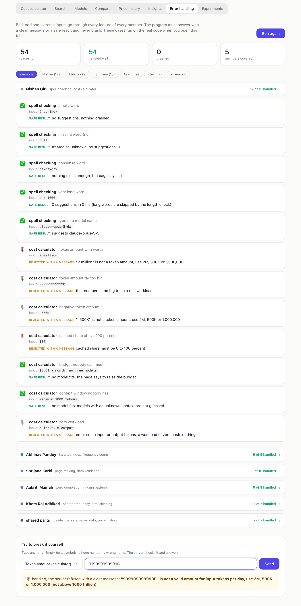

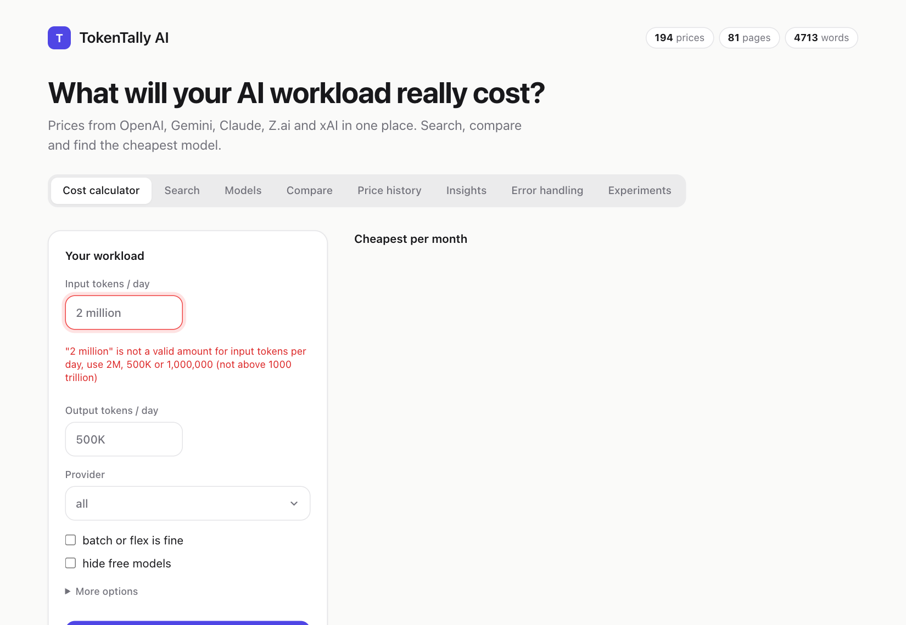

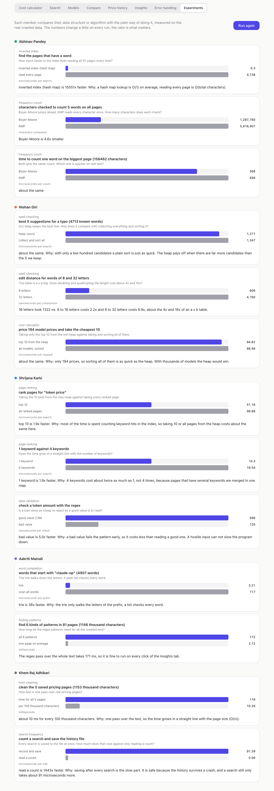

### "What if I..." buttons in the page and the menu

Instead of typing the strange input yourself, every tab has a row of "What if I..." buttons. A button fills in the real form with the strange value and presses the real button, so you see exactly what a user would see. Examples: type "2 million" as tokens, search for symbols, mistype a model name, compare 12 models, open a model that does not exist, ask for a $0.01 budget.

- a wrong value marks the field and says what is wrong under it
- a refused input shows an amber box with the reason ("Handled: nothing crashed")
- a safe answer with nothing found shows a green box and, for model names, a "did you mean" list
- the Error handling tab has the same buttons for the rest (empty word, capitals, a model that is not there, a huge number)
- in the menu, option 20 "what if I ..." lists the situations of each member as numbers, you pick one and it prints what you type, the result and what the program says

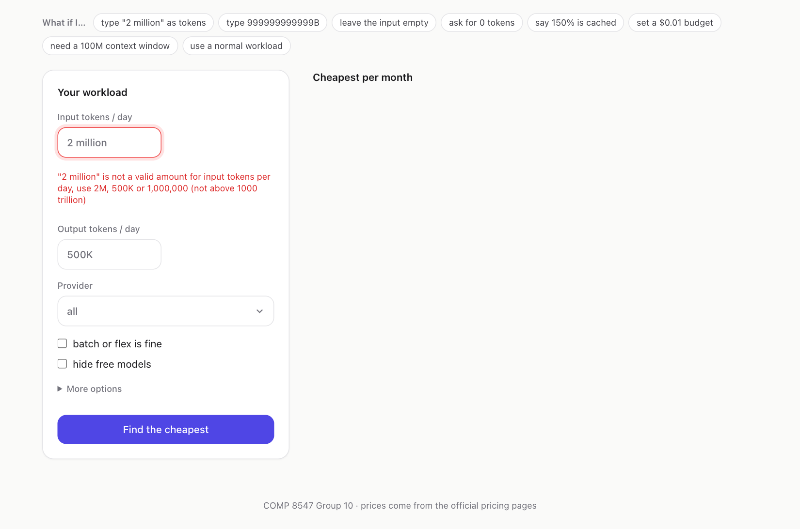

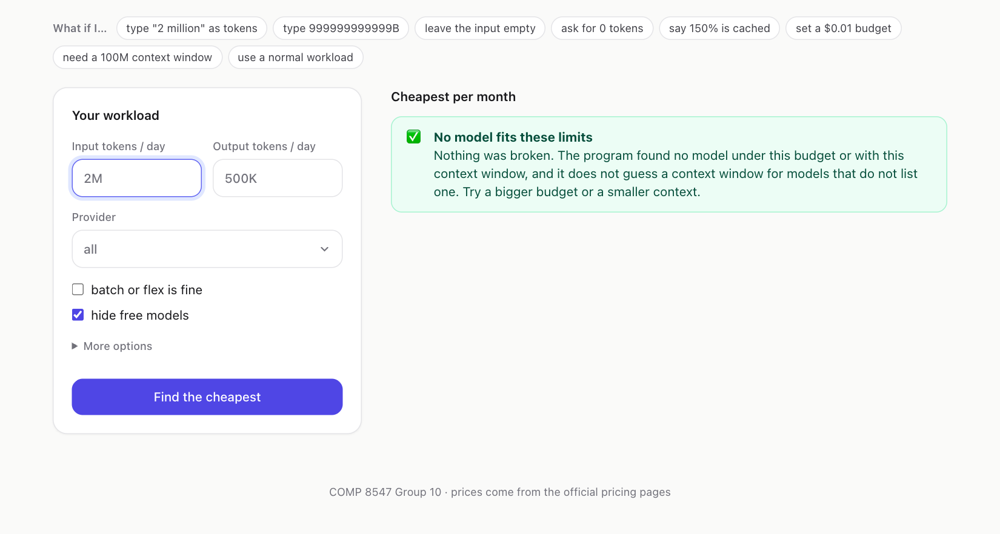

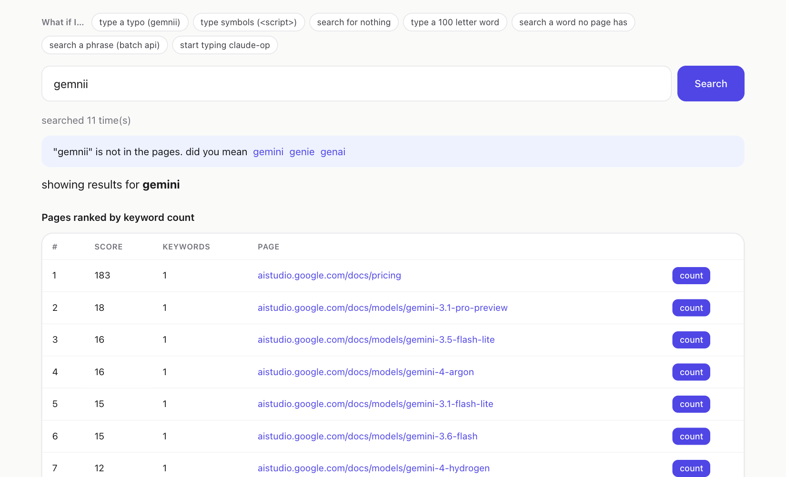

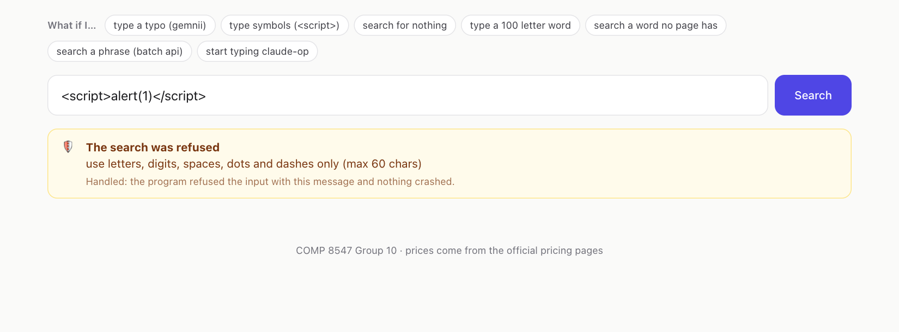

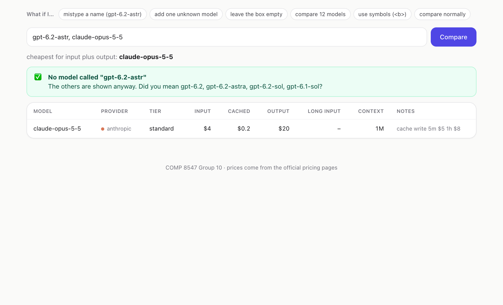

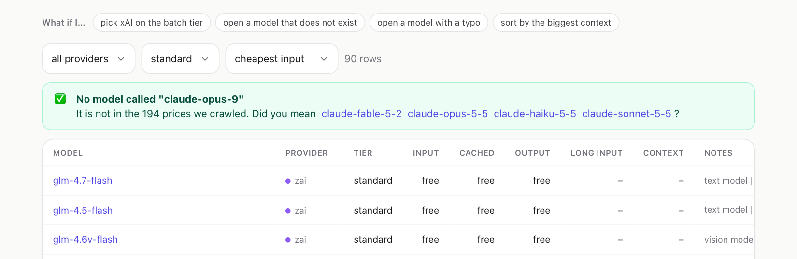

The menu print of the same cases (option 18, shortened to the first member):

```
running bad, odd and extreme inputs through every feature ...

== Nishan Giri
ok  spell checking / empty word  [(nothing)]
      -> no suggestions, nothing crashed
ok  spell checking / missing word (null)  [null]
      -> treated as unknown, no suggestions: 0
ok  spell checking / nonsense word  [qzxqzxqzx]
      -> nothing close enough, the page says so
ok  spell checking / very long word  [a x 1000]
      -> 0 suggestions in 1 ms (long words are skipped by the length check)
ok  spell checking / typo of a model name  [claude-opus-5-6x]
      -> suggests claude-opus-5-5
ok  cost calculator / token amount with words  [2 million]
      -> "2 million" is not a token amount, use 2M, 500K or 1,000,000
ok  cost calculator / token amount far too big  [999999999999B]
      -> that number is too big to be a real workload
ok  cost calculator / negative token amount  [-500K]
      -> "-500K" is not a token amount, use 2M, 500K or 1,000,000
ok  cost calculator / cached share above 100 percent  [150]
      -> cached share must be 0 to 100 percent
ok  cost calculator / budget nobody can meet  [$0.01 a month, no free models]
      -> no model fits, the page says to raise the budget
ok  cost calculator / context window nobody has  [minimum 100M tokens]
      -> no model fits, models with an unknown context are not guessed
ok  cost calculator / zero workload  [0 input, 0 output]
      -> enter some input or output tokens, a workload of zero costs nothing

== shared parts
ok  crawler / url that is not a url  [ht!tp://bad url]
      -> rejected: bad url ht!tp://bad url
ok  crawler / server that is not there  [http://localhost:1/]
      -> the crawl logs it and goes on: no connection for http://localhost:1/ (tried twice)
ok  parsers / page that is not a pricing page  [<html><body>hello</body></html>]
      -> 0 prices found, no crash
ok  parsers / empty and broken html  [(nothing) and <table><tr><td>]
      -> 0 and 0 prices found, no crash
ok  saved data / damaged prices.csv  [one good row, one broken number, one short row]
      -> 1 good row loaded, 2 damaged rows skipped
ok  saved data / data folder that does not exist  [/no/such/folder]
```

## Screenshots

Cost calculator, cheapest models per month for a workload:

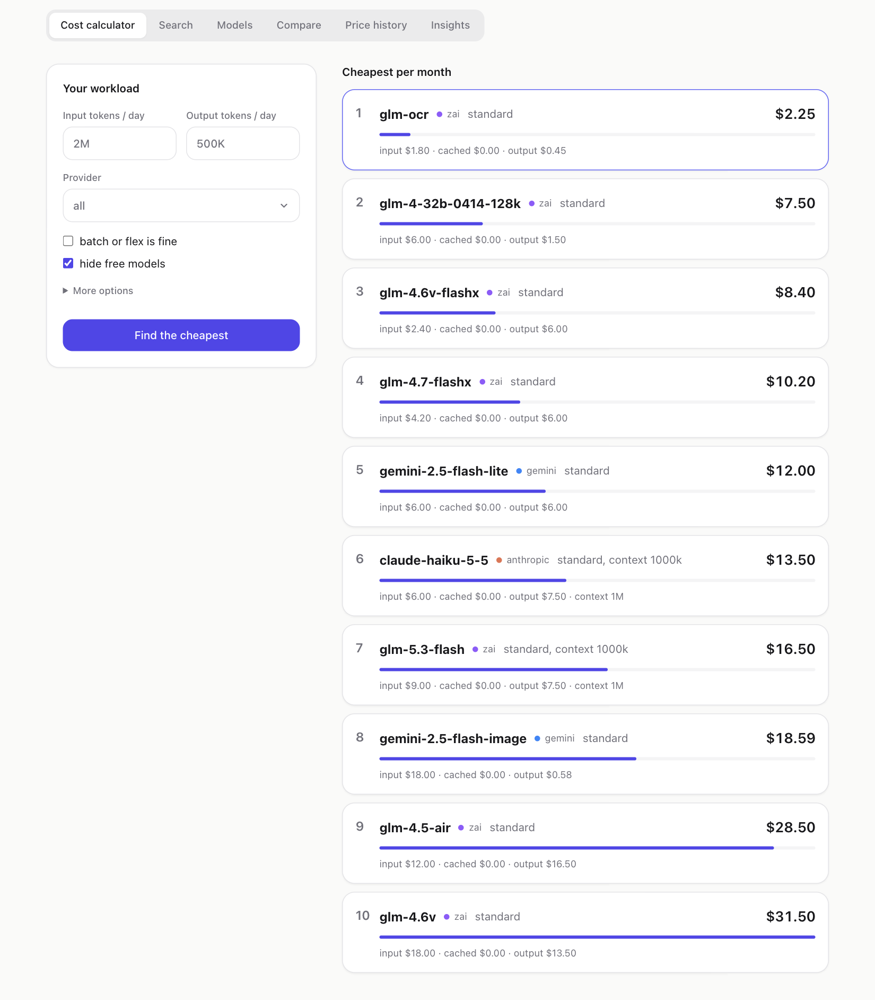

Search with a spell suggestion, ranked pages and a frequency count:

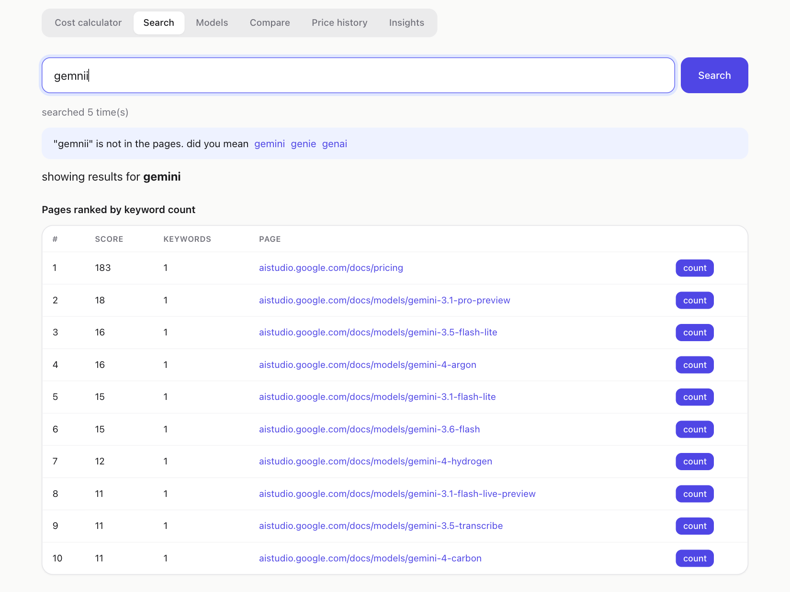

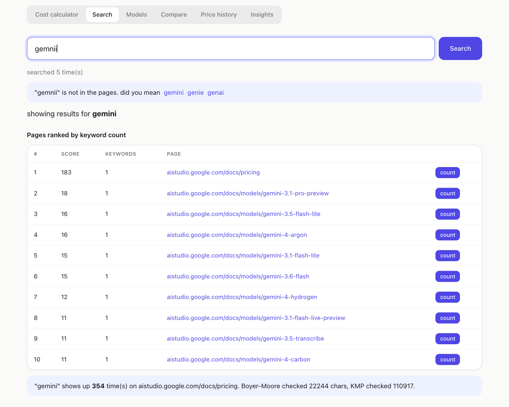

Word completion while typing:

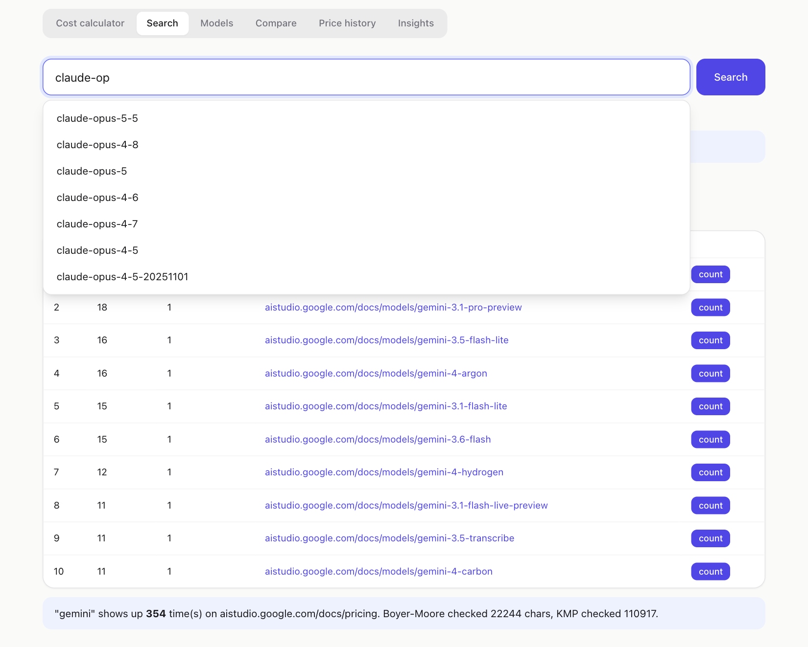

Models with a model card, and compare:

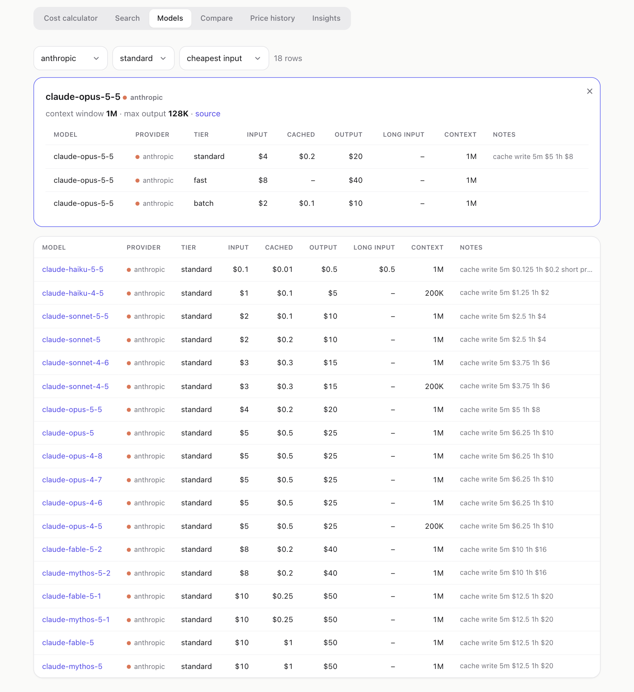

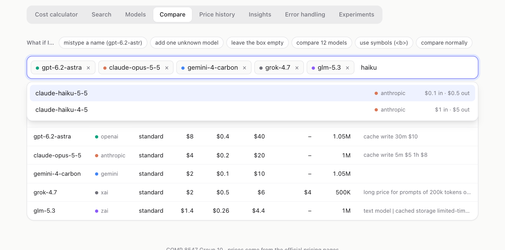

Price history. The button shows an example, those two changes are made up and are not real prices:

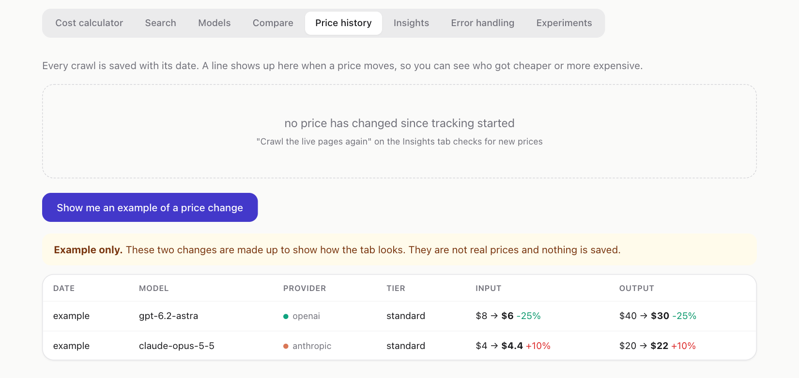

Insights, free models, price warnings and patterns found with regex:

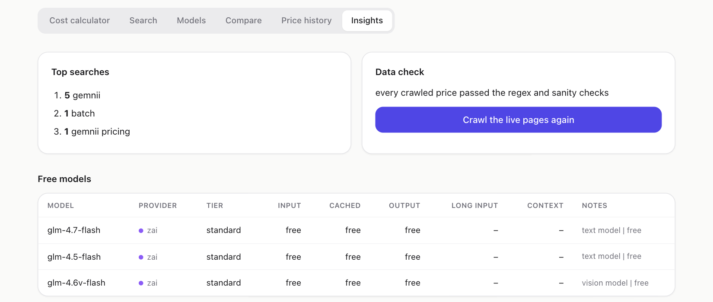

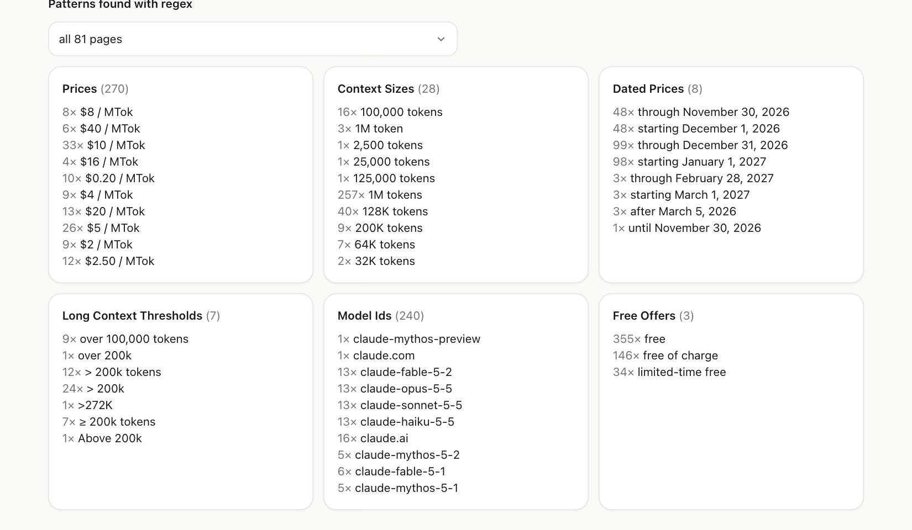

The full report with numbered figures is in `docs/report/TokenTally_AI_Report.docx`.

## Run it in Eclipse

Use "Eclipse IDE for Enterprise Java and Web Developers" (it has Maven built in).

Menu version (`core`):
1. File > Import > General > Existing Projects into Workspace, pick the `core` folder.
2. Open `src/main/java/tokentally/app/TokenTallyApp.java`, right click > Run As > Java Application.
3. The menu shows in the console. It uses the saved pages in `core/data`. Pick option 12 to crawl the live pages again.

Web version (`api`):
1. File > Import > Maven > Existing Maven Projects, pick the `api` folder.
2. If Eclipse asks to install a connector for build-helper-maven-plugin, accept it. If a red error stays, right click the project > Maven > Update Project.
3. Open `tokentally/api/ApiApplication.java`, right click > Run As > Java Application.
4. Open http://localhost:8080 in the browser.

Tests: open `src/test/java/tokentally/TestRunner.java` in `core` and Run As > Java Application. It prints how many checks passed.

## Run it from the terminal

Mac or Linux:

```
cd core && ./run.sh        # menu
cd core && ./test.sh       # all checks
cd api && ./run.sh         # web page on http://localhost:8080
```

Windows (command prompt, needs the jdk on the path, and maven for `api`):

```
cd core
run.bat                    & menu
test.bat                   & all checks
cd ..\api
run.bat                    & web page on http://localhost:8080
```

If port 8080 is busy, start the api with `SERVER_PORT=8090 java -jar target/tokentally-api-1.0.jar` (on Windows: `set SERVER_PORT=8090` first).

Run the menu from inside the `core` folder (Eclipse does this for you), because the saved data is found with the path `data`. The web page needs no internet, the back end works offline with the saved data. Only the crawl needs internet.

## Price history

Every time the data is loaded or crawled, `core/data/price_history.csv` gets a new line for each price that is new or different. The first line of a model is its first price, the next lines are changes. The menu (option 13) and the "Price history" tab show what moved and by how many percent. Crawl again on another day to see real changes.

## Where each feature lives

| Feature | Files |
|---|---|
| web crawler | `crawl/WebCrawler`, `crawl/*Crawler`, `crawl/RobotsTxtChecker`, `crawl/Fetcher` |
| html parser | `parse/HtmlCleaner`, `parse/*Parser` |
| spell checking | `text/SpellChecker`, `text/EditDistance` |
| word completion | `text/Trie`, `text/WordCompleter` |
| frequency count | `text/FrequencyCounter`, `text/BoyerMoore`, `text/KMPMatcher` |
| search frequency | `search/SearchFrequency` |
| page ranking | `rank/PageRanker`, `util/Heap` |
| inverted indexing | `text/InvertedIndex` |
| data validation | `regex/InputValidator` |
| finding patterns | `regex/PatternExtractor` |
| cost calculator | `cost/Workload`, `cost/Recommender`, `cost/CostCalculator` |
| price history | `app/PriceHistory` |
| menu | `app/TokenTallyApp`, `app/Engine` |
