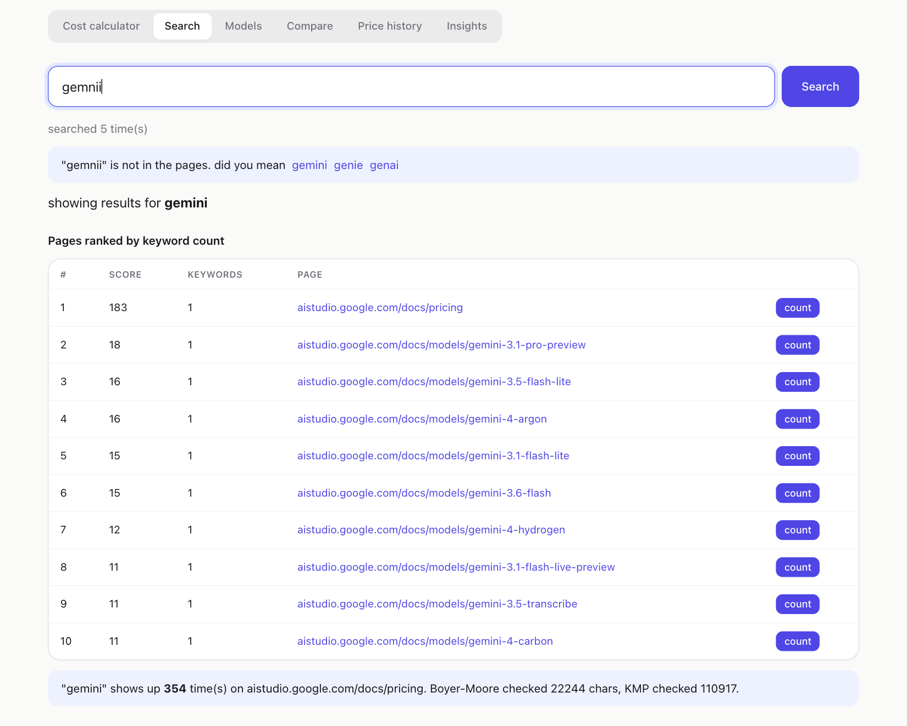
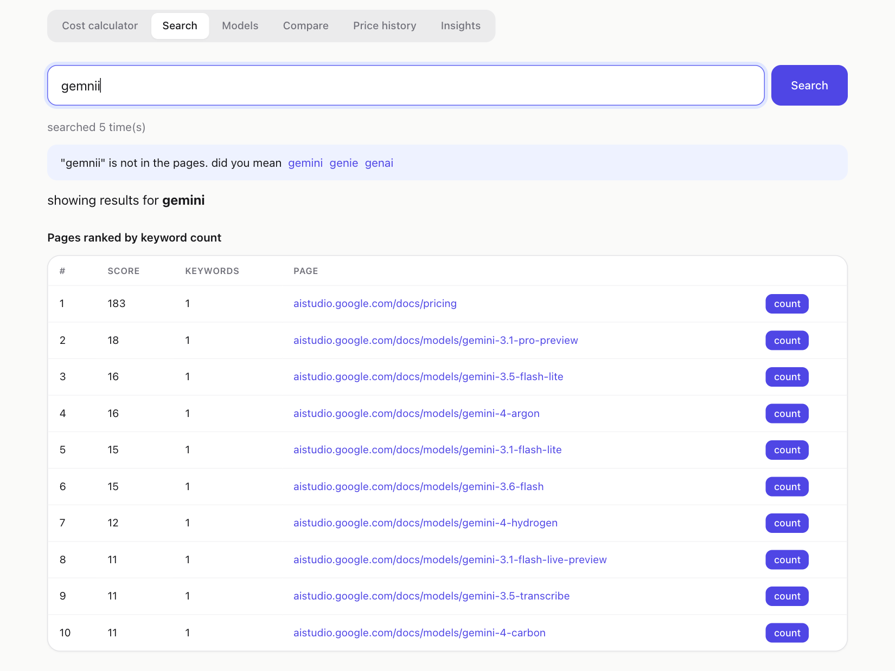
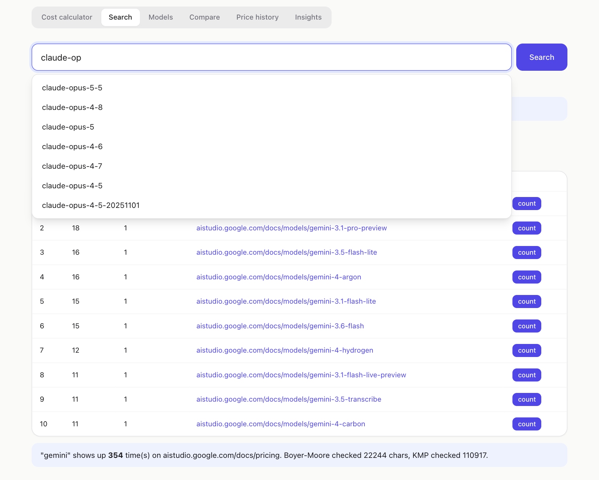
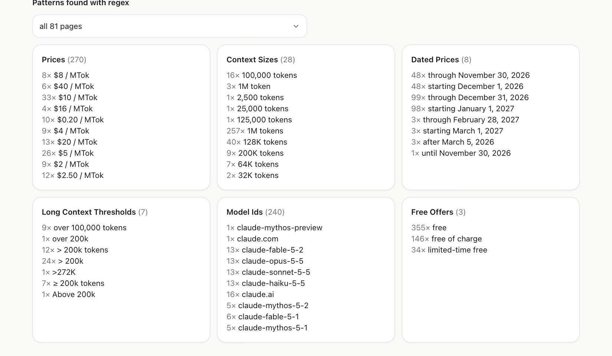
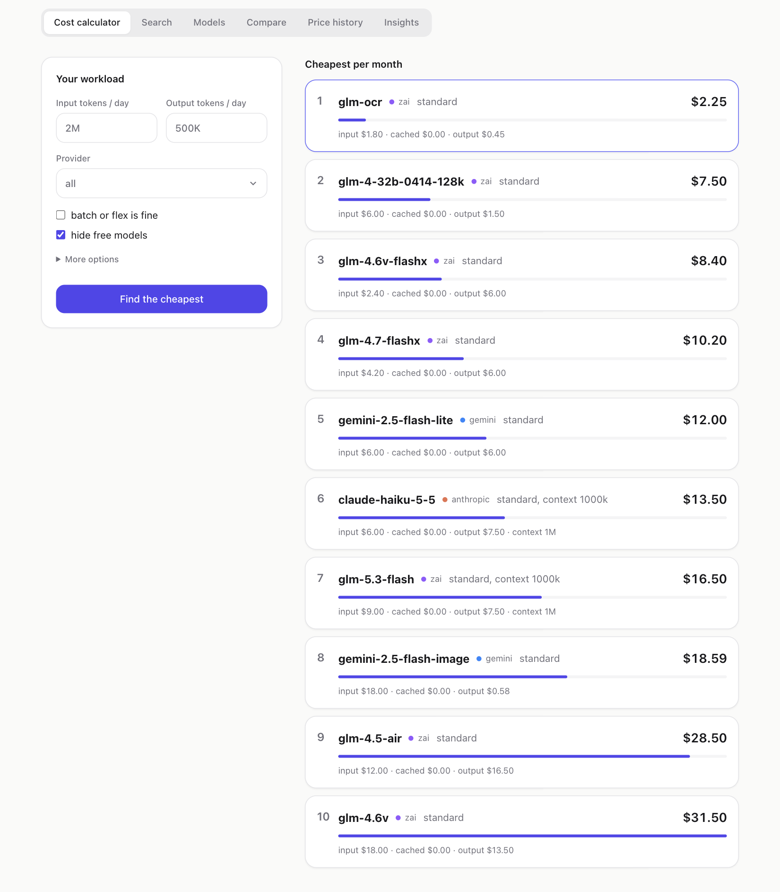
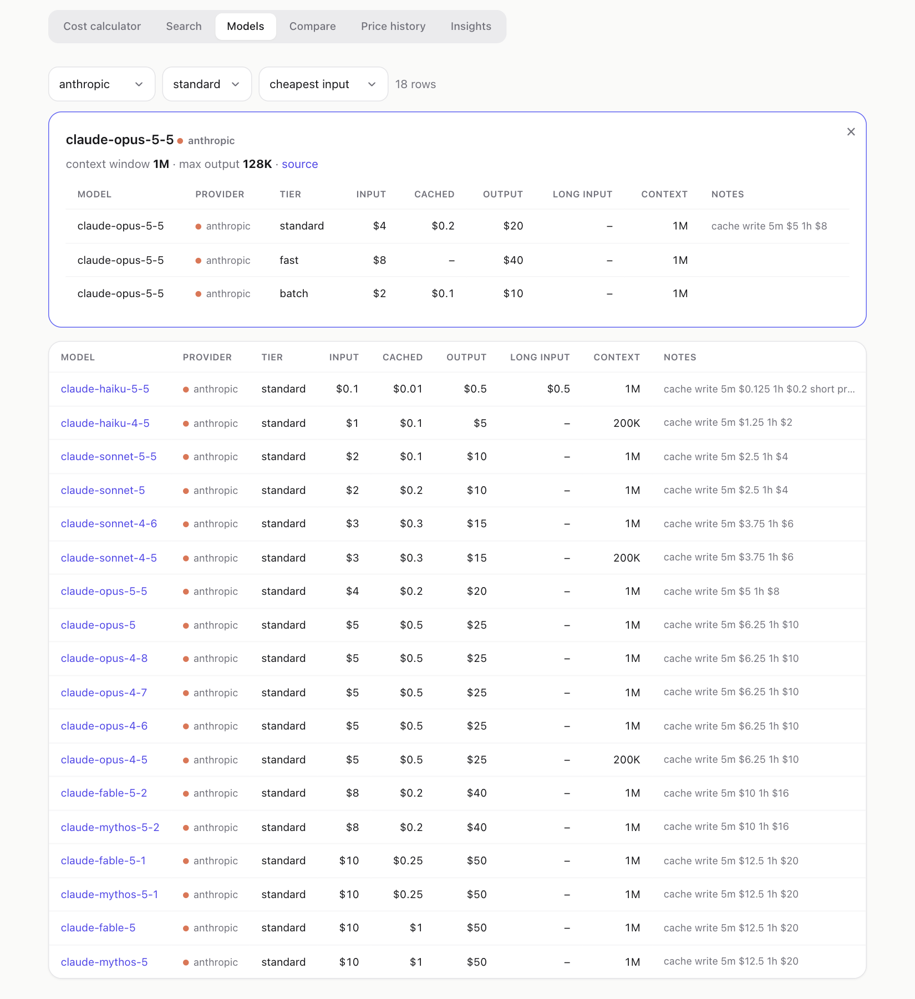
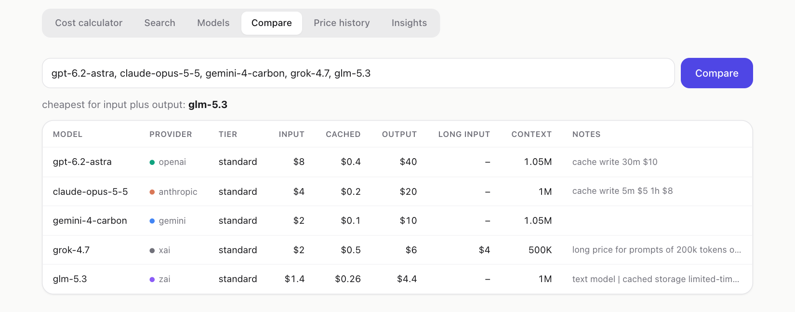
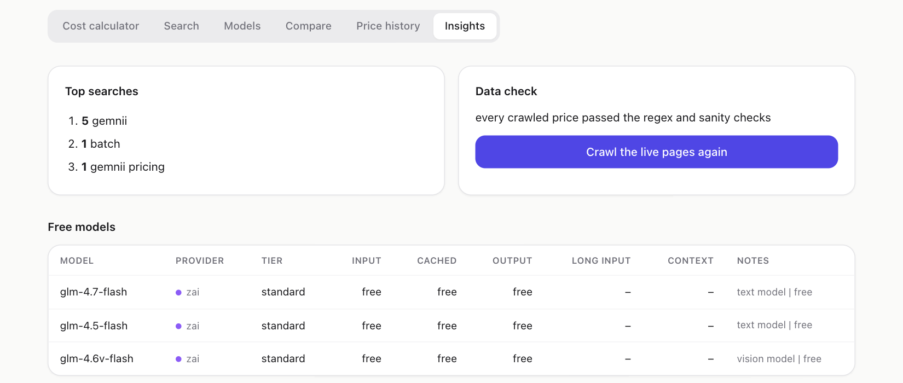
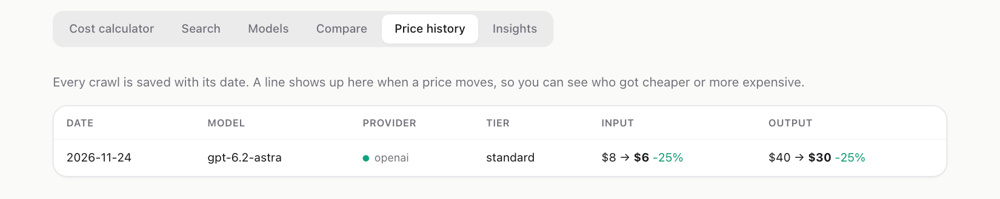

# 1 group and variant

| member | provider crawled | features | main java files |
|---|---|---|---|
| Nishan Giri | Anthropic Claude | spell checking, workload cost calculator | AnthropicCrawler, AnthropicParser, SpellChecker, EditDistance, Workload, CostCalculator, Recommender |
| Abhinav Pandey | OpenAI | inverted indexing, frequency count | OpenAICrawler, OpenAIParser, InvertedIndex, FrequencyCounter, BoyerMoore, KMPMatcher |
| Shrijana Karki | Google Gemini | page ranking, data validation | GeminiCrawler, GeminiParser, PageRanker, InputValidator |
| Aakriti Mainali | Z.ai | word completion, finding patterns | ZaiCrawler, ZaiParser, Trie, WordCompleter, PatternExtractor |
| Khem Raj Adhikari | xAI Grok | search frequency, html cleaning | XaiCrawler, XaiParser, HtmlCleaner, SearchFrequency |

Shared files are ModelPrice, Page, Crawler, WebCrawler, Fetcher, RobotsTxtChecker, Heap, Tokenizer, DataStore, CrawlAll, Engine and TokenTallyApp. The extra feature price history (PriceHistory) is shared.

Code and data are in the public repository https://github.com/Nis-lab-art/tokentally-ai

# 2 what the program does

AI model prices are spread over five different pricing pages and each page looks different. TokenTally AI crawls the official pricing pages of OpenAI, Google Gemini, Anthropic Claude, Z.ai and xAI Grok and turns every model price into one format. After that the user can search the pages, compare models and work out the monthly cost of a workload.

The last crawl found 81 pages, 194 model prices and 4713 different words in the index. The front end is only a small web page, all features live in the plain java back end that uses only the jdk.

# 3 how it is built

The data goes through the same steps for every provider.

```
crawler (queue + hash set)  ->  html cleaner  ->  parser per provider
   ->  data store (csv + text files)  ->  engine  ->  features
   ->  menu (TokenTallyApp) or spring boot page (api)
```

Figure 1 Data flow of the program (text diagram)

The folders are core (plain java, all features), api (spring boot, serves one html page) and docs. The core compiles with javac and also works as an eclipse project. The saved crawl in `core/data` lets the program run without internet.

# 4 crawler and data collection

The `WebCrawler` does a breadth first search. It keeps a **queue** of urls to visit and a **hash set** of urls already seen so a page is never fetched twice. Each provider has its own start url and a rule that says which links to follow. Urls are cleaned first (no # part, no query, no slash at the end) and images are skipped. The crawler stops at depth 2 or after 20 pages, waits 400 ms between requests and reads robots.txt before fetching. Time is O(pages + links) because every page and link is handled once.

If a page fails the crawler writes the error to the log and goes on with the next page. If the first page of a provider fails the old saved data for that provider is kept.

```
FIGURE_CRAWL
```

Figure 2 Live crawl of the five providers from the command line (about one minute, the two 404 lines are broken links on the Z.ai docs)

# 5 features

## 5.1 html cleaning (Khem Raj Adhikari)

`HtmlCleaner` removes scripts, styles, svg and tags and turns the rest into plain text with single spaces. It is one pass over the page so it takes O(n). Parsers and the index only work on this clean text. See the crawl in Figure 2 and the parsers in section 5.12.

## 5.2 inverted indexing (Abhinav Pandey)

`InvertedIndex` is a **hash map from word to url to a list of positions**. Adding a page costs O(words) and looking up a word is O(1) on average. Because the positions are saved we can also do phrase search (words next to each other). The index holds 4713 words.

## 5.3 frequency count (Abhinav Pandey)

The user can count one word on one page with two string search algorithms we wrote ourselves, **Boyer-Moore** and **KMP**. KMP needs O(n + m) time with a prefix table. Boyer-Moore uses a bad character table and usually skips ahead so it checks fewer characters. The page shows how many characters each one compared.

{width=100%}

## 5.4 spell checking (Nishan Giri)

`EditDistance` fills a **dynamic programming table** with the number of inserts, deletes and changes between two words, O(a x b). `SpellChecker` compares an unknown word to the known words and keeps the best few in a **heap**. When a search finds nothing the program searches again with the best suggestion.

{width=100%}

```
FIGURE_SEARCH
```

Figure 5 The same search in the command line menu

## 5.5 page ranking (Shrijana Karki)

`PageRanker` uses the inverted index. A page scores the number of times the keywords show up and a tie is won by the page with more different keywords. The pages are put in a **max heap** and the top ten come out in order, O(n log n). This is ranking by keyword count, it does not use links between pages (see section 8).

The ranked table is visible in Figure 4 and Figure 5.

## 5.6 data validation (Shrijana Karki)

`InputValidator` uses **regular expressions** to check everything the user types, search words, token amounts like 2M or 500K, percents and money. The same check runs for the menu and the web page. Bad input gives a short message and never a stack trace. The crawled prices are also checked with sanity rules and the result shows in the Data check box (Figure 14).

```
FIGURE_BAD
```

Figure 6 Search with bad input is stopped with a short message

## 5.7 word completion (Aakriti Mainali)

`Trie` stores every word letter by letter with a count on the word. Finding the words that start with a prefix costs the length of the prefix and then the size of that part of the tree. `WordCompleter` keeps the most used words in a **heap**. Model ids are added to the words so claude-op completes to the claude models.

{width=100%}

```
FIGURE_COMPLETION
```

Figure 8 Word completion in the command line menu

## 5.8 search frequency (Khem Raj Adhikari)

`SearchFrequency` counts how many times each search was made. It uses a **hash map** that is saved to a file so the counts stay after the program is closed and a **tree map** for the top list. Broken lines in the file are skipped when loading. The counts show as Top searches (Figure 14).

## 5.9 finding patterns (Aakriti Mainali)

`PatternExtractor` finds prices, context sizes, dated prices, long context limits, model ids and free offers in the page text with regular expressions and counts how often each one shows up. The same patterns fill in the context window and max output of a model from its own page.

{width=100%}

## 5.10 workload cost calculator (Nishan Giri)

The user gives tokens per day (input and output) and can add the share that hits the cache, the size of one request, the smallest context window, a budget, one provider and whether batch is fine. For each model the monthly cost is

days x (uncached input x input price + cached input x cached price + output x output price) / 1 million

Long context prices are used when one request is as big as the long context limit. Only the standard tier is used and batch or flex tiers when batch is fine. `Recommender` keeps the cheapest models in a **min heap** and shows one row per model. Models with an unknown context window are left out when a smallest context is set. The option hide free models leaves out the free Z.ai models that would always be first.

{width=100%}

```
FIGURE_CALC
```

Figure 11 Cost calculator in the command line menu (20 percent cached, 250K requests, budget 500 dollars)

## 5.11 models and compare

The Models tab lists every price with filters for provider and tier and sorts by price or context window. Clicking a model opens a card with its prices, context window and the source page. Compare puts a few models side by side and says which one is cheapest for input plus output.

{width=100%}

{width=100%}

## 5.12 parsers

Every provider needs its own parser because the pages are built in different ways. OpenAI has a table for each tier tab and a second table for the same tier means a scheduled price change. Claude has two header rows and retired models are skipped. The Gemini page is markdoc text inside the html. Z.ai has plain tables and its free tier is price 0. xAI has a text table with short and long context and a separate batch discount table. All parsers fill the same `ModelPrice` object, prices are in dollars per million tokens and -1 means the page did not list the value.

## 5.13 insights, free models and price warnings

The Insights tab shows the top searches, the data check, the free models, price warnings (for example scheduled price changes) and the patterns.

{width=100%}

# 6 extra feature, price history

A price tracker needs to remember old prices. Each time the data is loaded or crawled `PriceHistory` compares every price with the last one it knows and writes a dated line to `price_history.csv` only when the price is new or different. The file only grows, nothing is rewritten. The Price history tab and menu option 13 show every price that moved with the old price, the new price and the change in percent. Looking at the whole log costs O(lines) with a hash map that holds the last price of every model.

The log starts on the day of the first run so changes only show after a later crawl. Figure 15 uses a copy of the data where one price was changed by hand to show how a change looks. It is demo data and not a real price change.

{width=100%}

```
FIGURE_HISTORY
```

Figure 16 Price history in the command line menu with the real data (no price has changed yet)

# 7 testing

We wrote a small test runner ourselves (`TestRunner`) that counts passed and failed checks without a test library. It has 133 checks for the heap, robots.txt rules, url cleaning, html cleaner, all five parsers, tokenizer, inverted index, Boyer-Moore and KMP (compared with a slow count), edit distance, spell checker, trie, search frequency file, ranking, validation, patterns, cost calculation, recommendation filters, the price history log and the saved data (speed and accuracy). All checks pass. The web page was checked by hand and the live crawl was run again for this report.

```
FIGURE_TESTS
```

Figure 17 All checks pass (test.sh)

# 8 limits we know about

- we read html pages and not an api so a redesign of a pricing page can break a parser, the data check and the saved pages help with this
- cost only looks at text token prices, not quality, speed, rate limits or tool fees
- page ranking counts keywords and does not use links between pages
- some models have no context window because the page does not list it, we show a dash and do not guess
- the crawl button has no login and we did not test many users at once
- price history has no real changes until more crawls are done
- the scheduled email report from the proposal was dropped, we built price history instead because it needs no passwords or mail server

# 9 how to run

See the README in the repository. In short, open the core folder in eclipse and run `TokenTallyApp` for the menu or import the api folder as a maven project and run `ApiApplication` and open http://localhost:8080. There are also `run.sh` and `run.bat` files.

# 10 team work

Each member wrote and studied the crawler, parser and two features listed in section 1 and can explain their own files. Shared parts were done together. Some code was written with the help of an AI assistant, each of us reviewed and tested our own part. (each member to check this section and add what they did)

# 11 references

- OpenAI API pricing page, https://developers.openai.com/api/docs/pricing (read 24 November 2026)
- Google Gemini API pricing page, https://ai.google.dev/gemini-api/docs/pricing (read 24 November 2026)
- Anthropic Claude pricing page, https://platform.claude.com/docs/en/about-claude/pricing (read 24 November 2026)
- Z.ai pricing page, https://docs.z.ai/guides/overview/pricing (read 24 November 2026)
- xAI pricing page, https://docs.x.ai/developers/pricing (read 24 November 2026)
- course lecture notes on tries, heaps, edit distance, KMP and Boyer-Moore
- Spring Boot documentation, https://spring.io/projects/spring-boot
- Tailwind CSS, https://tailwindcss.com
